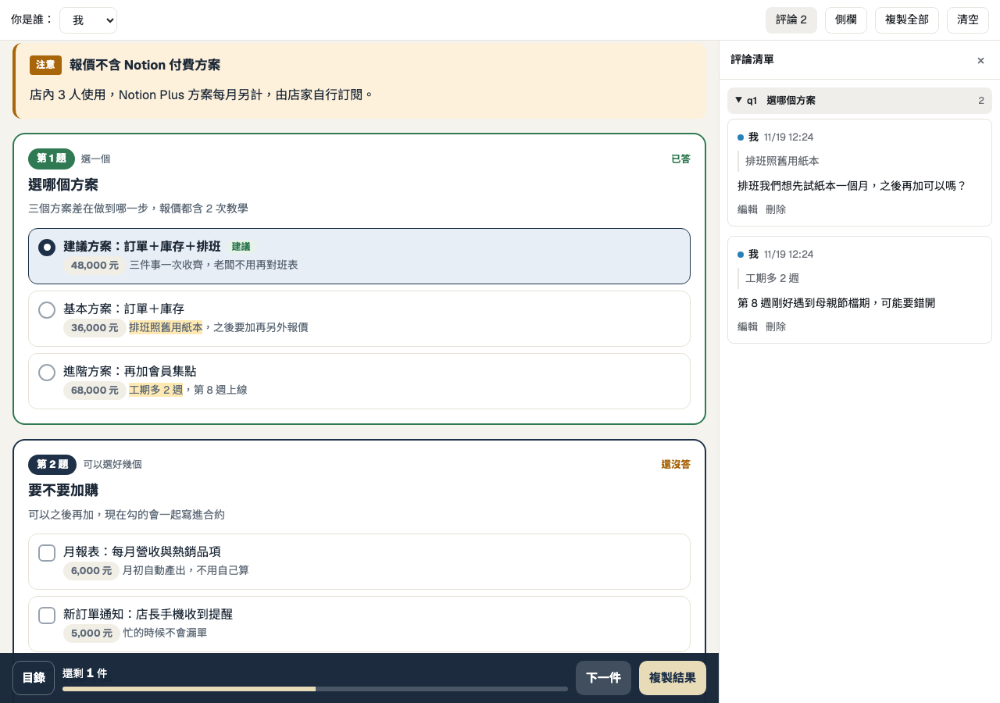

# 預覽技能（preview）：讓 Claude 把文件變成可以框選評論、直接作答的網頁

這是一個給 Claude 用的「技能」。裝好之後，你只要跟 Claude 說「**做成預覽**」，它就會把提案、計劃、草稿整理成一頁好讀的網頁，在你的瀏覽器打開。

你（或你的客戶）可以在這頁上：

- **第一眼就看到結論**：最上面的深藍首屏寫好一句話結論、要你做幾件事、什麼時候前要回
- **直接點選項作答**：要決定的事做成題目卡（單選、複選），建議選項會標出來
- **框選任何一段文字，留下評論**（像 Google 文件那樣）
- **用目錄跳段落**：底部進度列顯示還剩幾題，「下一件」直接跳到還沒答的
- **選擇自己是誰**，多人評論時分得出是誰寫的
- **一鍵「複製結果」**，把作答和評論變成一段文字，貼回給 Claude，它就會照著改

適合用在：接案提案給客戶確認範圍、專案計劃請對方拍板、文案草稿請人逐句給意見、合約逐條審、上線前檢查清單。

## 做出來長什麼樣





- 深藍首屏、暖米底色、白色卡片，手機上也好讀。
- 文字不會一整片：Claude 會把內容改寫成白話，並用圖像元件呈現，例如「現在 → 改完後」對照、系統架構圖、時間軸、步驟、數字卡、題目卡、彩色重點框。
- 每一段自動編號，標題寫成一句結論；細節收在「明細」裡，點了才展開。
- 頁頂工具列有「你是誰」選單、評論數、側欄、複製全部、清空；底部進度列有目錄、還剩幾件、下一件、複製結果。
- 作答和評論存在你自己的瀏覽器裡，重新整理不會不見。

想先看效果：裝好後跟 Claude 說「用預覽技能把範例提案做成預覽」，它會用技能內附的虛構範例（一間烘焙坊的 Notion 系統提案）做一頁給你看。

## 安裝

### 方法一：請 Claude 幫你裝（最簡單）

打開 Claude 桌面版的 **Code** 分頁，貼上這句話：

> 幫我從這個網址安裝技能：https://github.com/kevin8656/claude-skill-preview
> 把裡面的 preview 資料夾放到 ~/.claude/skills/ 底下。

Claude 會幫你下載並放到正確位置。裝好後**開一個新對話**，技能才會生效。

### 方法二：自己放

1. 在這個頁面按綠色的 **Code** 按鈕 → **Download ZIP**，下載後解壓縮。
2. 找到裡面的 `preview` 資料夾。
3. 把整個 `preview` 資料夾放到：
   - macOS：`~/.claude/skills/`（在 Finder 按 `Command + Shift + G`，貼上 `~/.claude/skills/` 前往；沒有 `skills` 資料夾就自己建一個）
   - Windows：`C:\Users\你的使用者名稱\.claude\skills\`
4. 放好後的路徑應該是 `~/.claude/skills/preview/SKILL.md`。
5. 開一個新的 Claude 對話。

### 已經裝過舊版，要更新

跟 Claude 說：

> 幫我把 ~/.claude/skills/preview 更新成 https://github.com/kevin8656/claude-skill-preview 的最新版，整個資料夾換掉。

或照方法二重新下載，把舊的 `preview` 資料夾整個刪掉再放新的（不要只覆蓋，舊版有一個樣式檔這版已經拿掉）。以前做的 md 不用改，重新產生就是新樣子。

### 需要的環境

- **Python 3.9 以上**，不需要另外安裝任何套件。
  - macOS：第一次執行時系統可能跳出「安裝開發者工具」的視窗，按安裝即可。
  - Windows：到 python.org 下載安裝，安裝時勾選「Add Python to PATH」。
- 一個瀏覽器（Chrome、Edge、Safari 都可以）。

不確定有沒有裝好，直接問 Claude：「幫我檢查電腦有沒有 Python 3.9 以上」。

## 怎麼用

跟 Claude 說這些話都可以叫出這個技能：

- 「把這份提案**做成預覽**」
- 「做一個**可以評論的版本**給我看」
- 「把這些選項**出成題目**讓我選」
- 「把這份合約做成預覽，**原文一個字都不要改**」
- 「做一份**給客戶評論**的版本」

### 一個完整的來回

1. 你：「把剛剛的提案做成預覽。」
2. Claude 改寫成白話版，產出網頁並用瀏覽器打開。
3. 你看首屏就知道要做什麼；在題目卡點選項作答，有意見的地方框選文字留評論。
4. 按底部「**複製結果**」，回到對話貼上。
5. Claude 照你的答案和評論逐條修改，重新產生網頁。作答和評論會接回原本的位置。

### 給客戶評論

1. 跟 Claude 說「做一份給客戶評論的版本，身份設成客戶和我」。
2. 把產出的 HTML 檔，**連同旁邊的 `preview-fonts` 資料夾**一起壓縮成 zip 傳給客戶。想只傳一個檔案，就跟 Claude 說「做成單一檔案」，它會改用電腦內建的字型。
3. 客戶打開 HTML，作答、評論完按「複製結果」，把文字傳回給你。
4. 你把那段文字貼給 Claude 就能套用。

> 作答和評論存在客戶自己的瀏覽器裡，不會自動同步給你，所以一定要請對方按「複製結果」傳回來。

## 常見問題

**裝了但 Claude 好像不知道這個技能？**
確認路徑是 `~/.claude/skills/preview/SKILL.md`（不是多包一層資料夾），然後開新對話再試一次。

**字型看起來怪怪的？**
HTML 旁邊的 `preview-fonts` 資料夾不見了。重新產生一次，或把資料夾放回 HTML 同一層；也可以請 Claude 做成單一檔案版。

**評論或作答不見了？**
都存在瀏覽器裡。換瀏覽器、用無痕視窗，或清除瀏覽紀錄都會看不到。重要的記得按「複製結果」存起來。按工具列的「清空」只會清評論，不會清作答。

**以前用舊版做的 md 還能用嗎？**
可以。舊寫法照樣能跑，產出來就是新樣子；開頭的「結論」框會自動搬進首屏。

## 資料夾內容

```text
preview/
├── SKILL.md                 給 Claude 看的使用說明
├── scripts/
│   ├── md-to-preview.py     產生器：Markdown 轉預覽網頁
│   └── convert/             外殼、互動、圖像元件、流程圖、表格轉換與評論注入
└── assets/
    ├── preview-comment-overlay.html   框選評論介面
    ├── preview-tokens.css             顏色、字型、間距設定
    ├── example.md                     虛構的接案提案範例
    └── fonts/                         自帶字型（SIL OFL 授權）
```

## 更新紀錄

- **2026-11**：換成深藍首屏、暖米底、白卡的新版面；新增首屏、題目卡（單選、複選）、待辦、收合明細的寫法；左側目錄改成浮動目錄加底部進度列；連續幾張圖自動左右並排；可選單一檔案輸出；複製結果會一起帶出作答。
- **2026-10**：第一版：框選評論、勾選確認、白話圖像元件。

## 授權

- 程式與說明文件：MIT License，作者 領先時代數位 老K，見 `LICENSE`。
- 字型（Noto Sans TC、Geist、Geist Mono）：SIL Open Font License 1.1，見 `preview/assets/fonts/`。
